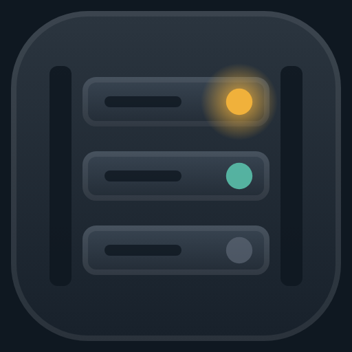
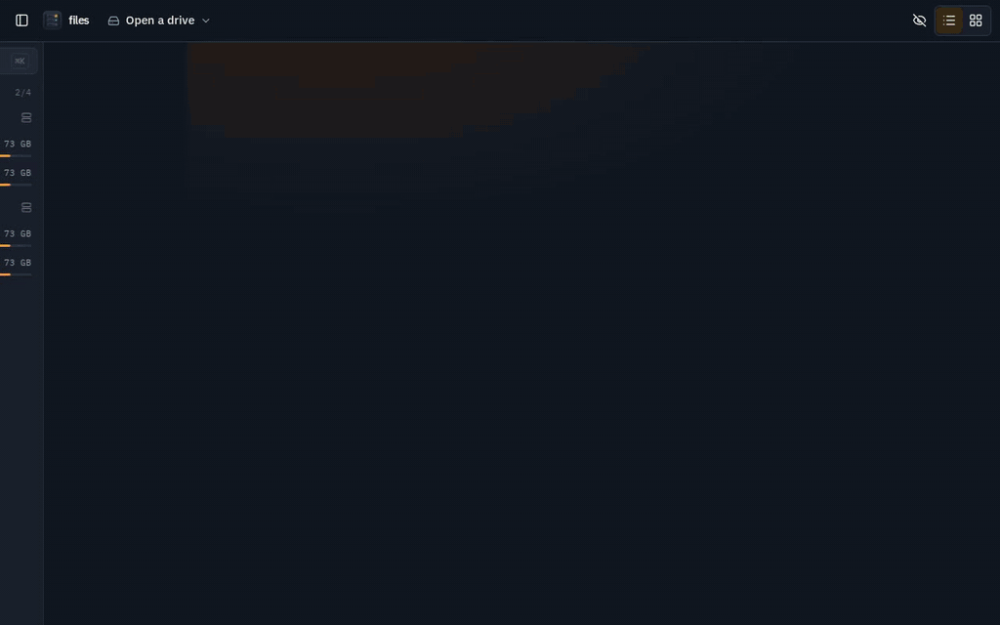
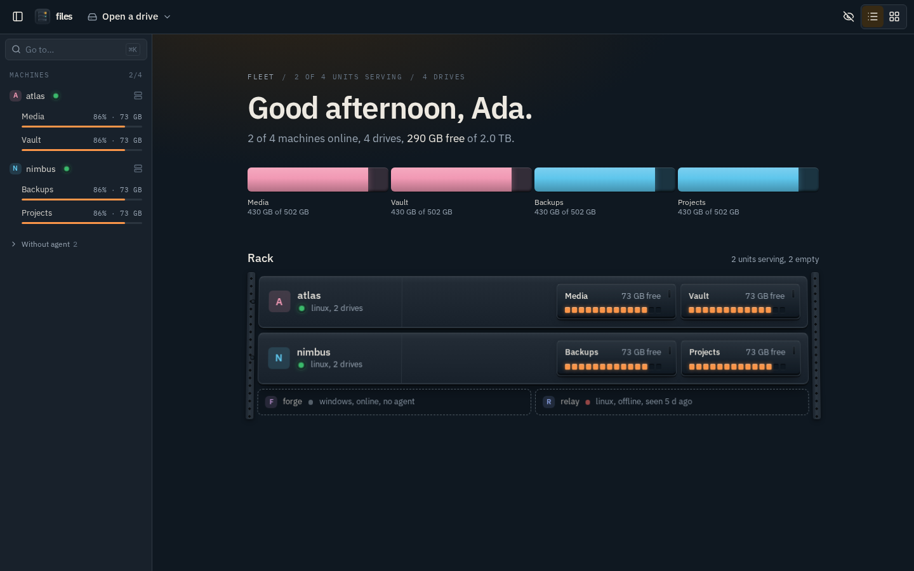
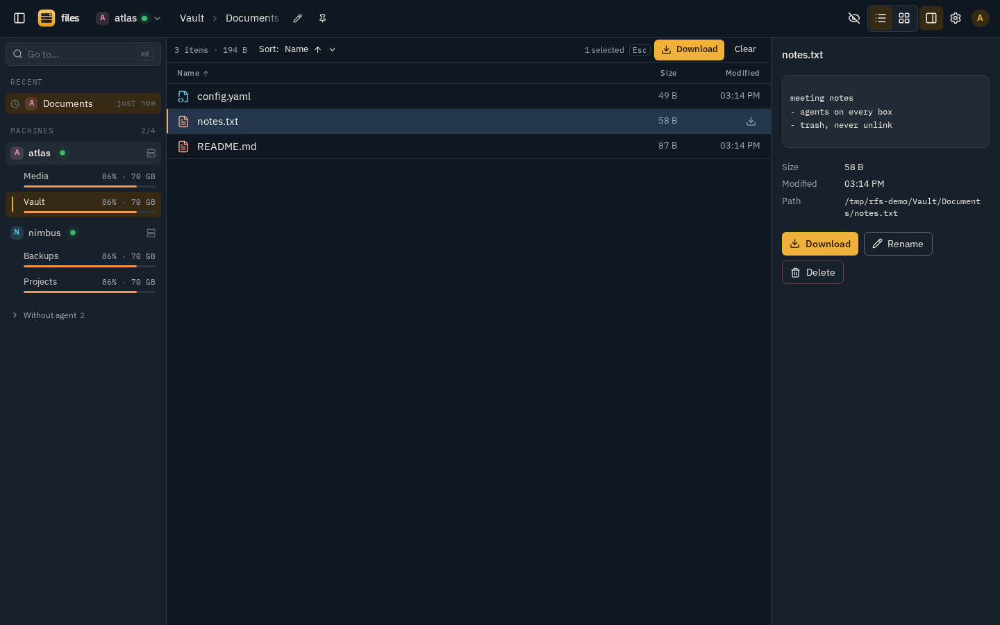
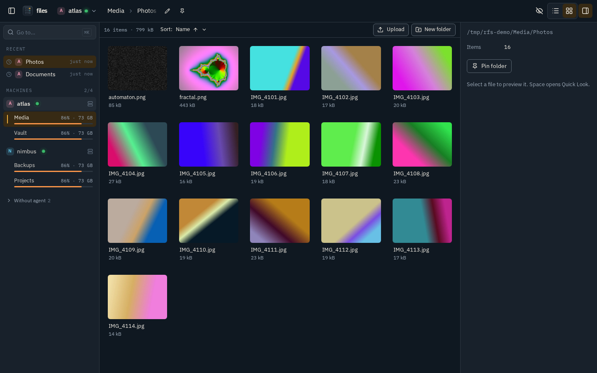
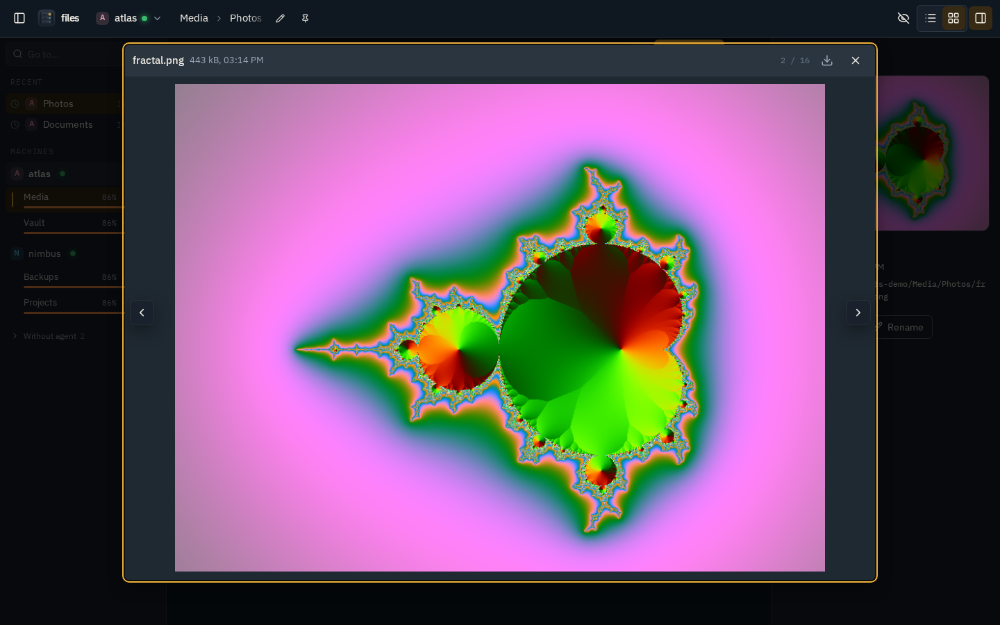
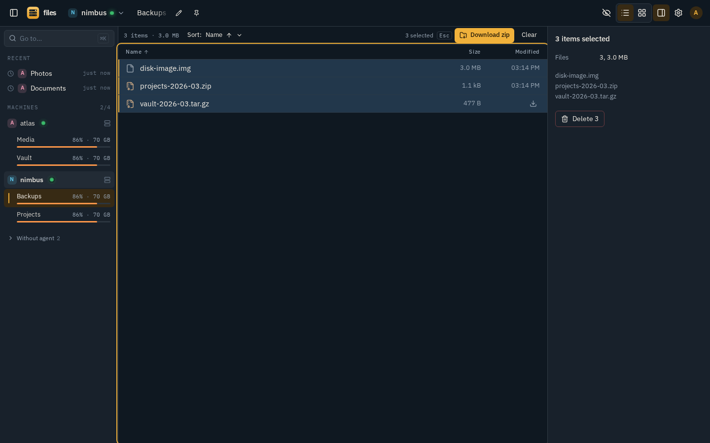
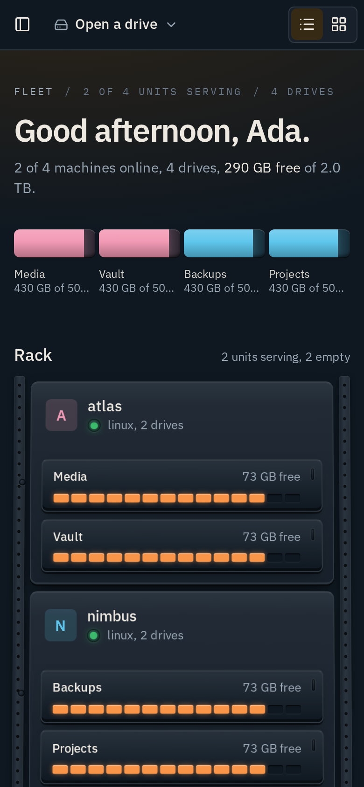
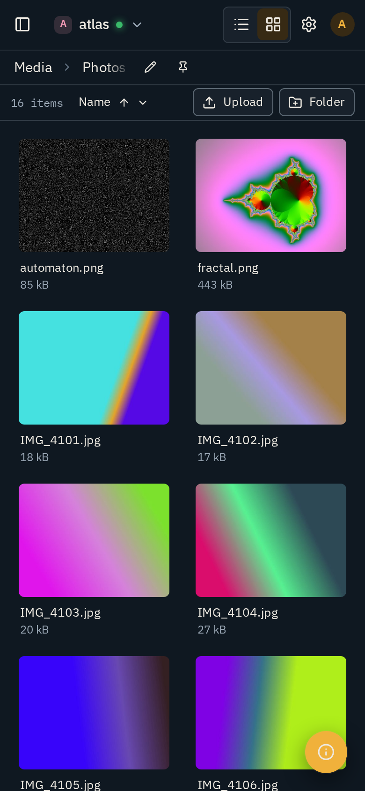
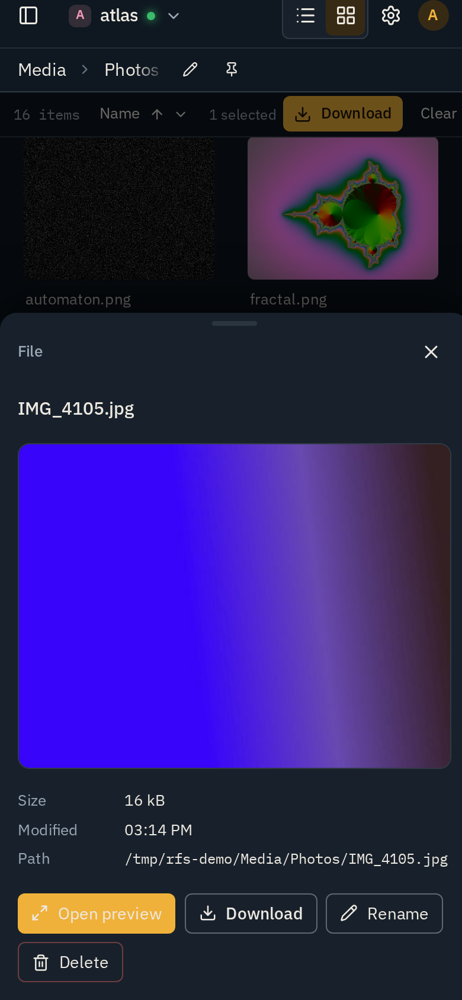

<p align="center">
  
</p>

<h1 align="center">rfs</h1>

<p align="center">
  Every drive on every machine, from anywhere.<br>
  A distributed personal file server for your Tailscale network, with a web UI that looks like the rack it is.
</p>

<p align="center">
  <a href="https://github.com/Rudra-roy/rfs/actions"></a>
  
  
  
</p>

<p align="center">
  
</p>

---

## What it is

You have a few machines. A desktop with three drives, a laptop, a box in a lab, maybe a Windows PC. rfs puts a small **agent** on each of them and one **hub** on whichever is always on. The hub shows one UI with every machine and every drive, and streams files from wherever they live. Nothing is copied or synced.

Access from outside your network goes through a Cloudflare Tunnel with Cloudflare Access in front, so no machine opens a port and your identity provider does the login. Inside the tailnet, hub and agents talk over WireGuard and agents only answer callers that Tailscale says are you.

## Features

**Browse**
- Every mounted filesystem on every agent, not just home directories. Bind mounts and pseudo filesystems are filtered out.
- List and grid views with real thumbnails for images and video, generated and cached on the machine that owns the file.
- Previews for images, video, audio, PDF, text and code. Space opens Quick Look; Left and Right step through the folder.
- Sortable columns, hidden-file toggle, per-folder scroll and view memory.

**Navigate**
- Go to box on `/` or Ctrl-K: machines, drives, pinned and recent folders, or a literal `machine:/path`.
- Filename search across every drive of every machine in milliseconds: each agent keeps a compact index per drive (a million entries scan in about 4 ms), persisted so restarts are instant, refreshed per folder on every write through the agent, rebuilt on a schedule scaled to the drive, and topped up by a short live walk so files created outside the agent still show. A hit opens its folder with the file selected.
- Breadcrumb chips, an editable location line, and a pin button on any folder.
- A drive switcher that works from any page, and a sidebar you can collapse.

**Move data**
- Drag-and-drop or button upload, chunked and resumable, sized to pass through Cloudflare's request limit.
- A transfer tray at the bottom of the app with rate, bytes left and per-file progress that survives navigation.
- Rename, new folder, multi-select with Shift and Ctrl, and delete that moves to a per-drive trash instead of unlinking.
- Zip download of any folder or multi-selection, streamed straight from the agent with already-compressed formats stored rather than re-deflated.

**Fleet**
- The landing page is a rack: one capacity bar for the whole fleet, each machine as a unit with its drives as sleds, LEDs for status, and empty slots for machines without an agent.
- Capacity turns orange above 70 percent and red above 90.
- Machines get a stable identity colour so you can tell a drive on one box from a drive on another at a glance, and you can give any machine a display name on the site without touching the tailnet.

**Locked down, in layers**
- Sign-in at the edge through Cloudflare Access with your identity provider and an email allowlist. The hub re-checks the signed token on every request.
- Optional two-step verification owned by the hub: enrol an authenticator app from Security settings, and every new browser must enter a code.
- Optional access password per machine, set on the machine and checked by the machine. The hub holds only a 12-hour unlock token, so even a compromised hub cannot read a locked machine.

**Built right**
- Streams everything. Directory listings paint as they arrive; file reads use `sendfile` with range support so video seeks are instant.
- Phone layout with a drawer, a bottom sheet for details, and 44 px touch rows. Keyboard navigation and visible focus everywhere. Respects reduced motion.
- A colour system with every text and icon pair checked against WCAG floors by a script in the repo.
- An audit log on the hub: one JSON line per API request with user, machine, path, status, bytes and duration.

## Screenshots

| | |
|---|---|
|  The rack: fleet bar, units, sleds, empty slots |  List view with details pane and toolbar |
|  Grid with thumbnails made by the agent |  Quick Look on Space |
|  Range selection and summary |    |

All captures come from the built-in demo fleet with synthetic data. See [Demo](#demo).

## Architecture

```
 browser anywhere                     browser on the tailnet (planned fast path)
      │ https                                   │
      ▼                                         │
 Cloudflare edge: Access login, allowlist       │
      │ outbound tunnel                         │
      ▼                                         ▼
 ┌────────────── hub ────────────────────────────────────┐
 │ rfs-hub  serves the UI, re-verifies the Access JWT,   │
 │          discovers agents from tailscaled, proxies     │
 └──────────────┬────────────────────────────────────────┘
                │ http over WireGuard, agents bind the tailnet IP only
   ┌────────────┼───────────────┬──────────────┐
   ▼            ▼               ▼              ▼
 rfs-agent    rfs-agent       rfs-agent      rfs-agent
 desktop      laptop          lab box        windows pc
 /, /media/*  all mounts      -mounts /data  C:, D:
```

Two static binaries from one Go module. The hub embeds the built React app. Adding a machine means starting an agent on it: the hub finds it through the local Tailscale API within fifteen seconds, no registration.

| Component | Does |
|---|---|
| `rfs-agent` | Enumerates mounts, serves list, stat, ranged read, chunked upload, rename, trash, thumbnails, zip, indexed filename search. Authorises callers with Tailscale `whois` and, if set, a per-machine access password. Flags: `-readonly`, `-mounts /a:Label,/b:Other`, `-port`, `-index-max` (entries per drive, 0 disables), `-set-password`, `-passfile`. |
| `rfs-hub` | Serves the SPA, validates Cloudflare Access tokens, polls the tailnet for agents, reverse-proxies file calls with keep-alive and streaming, fans search out to every drive, writes the audit log. Flags: `-addr`, `-agent-port`, `-audit` (or `RFS_AUDIT_LOG`), `-dev-email` (loopback only), `-demo-fleet`. |

## Quick start

Prerequisites: Tailscale installed and logged in on every machine, a domain on Cloudflare, and `ffmpeg` on agents if you want video thumbnails. Building from source needs Go 1.24+ and Node 22; the agent installer fetches Go for you if the system one is too old.

**1. Build**

```sh
git clone https://github.com/Rudra-roy/rfs && cd rfs
make build          # web UI, then bin/rfs-hub and bin/rfs-agent
```

**2. Run an agent on each machine**

```sh
deploy/install-agent.sh                       # systemd --user service on Linux
deploy/install-agent.sh -readonly             # never write to this machine
deploy/install-agent.sh -mounts /srv:Share    # expose only chosen directories
```

The installer uses a prebuilt binary from the latest release when one exists, otherwise it builds from the checkout. If the machine's Go is older than 1.24 it fetches a current toolchain into `~/.local/go`; no sudo needed. Set `RFS_BUILD=1` to force a source build.

**Android phones** run the agent inside Termux. See [Android phone agent](#android-phone-agent-termux) below.

For every-file access on a multi-user box, use `deploy/rfs-agent.system.service`, which runs as an unprivileged user with the read-all capability instead of root. For Windows, `make agent-windows` and run `rfs-agent.exe` as a service.

**3. Put the hub behind Cloudflare**

1. In Zero Trust, create a tunnel, add a public hostname such as `files.example.com` pointing at `http://localhost:7420`, and copy the tunnel token.
2. Add a self-hosted Access application for that hostname with a policy that allows your email, and copy its Application Audience tag and your team name.
3. On the hub machine:

```sh
mkdir -p ~/.config/rfs && cp deploy/hub.env.example ~/.config/rfs/hub.env && chmod 600 ~/.config/rfs/hub.env
$EDITOR ~/.config/rfs/hub.env     # RFS_ACCESS_TEAM, RFS_ACCESS_AUD, TUNNEL_TOKEN
cp deploy/rfs-hub.service deploy/cloudflared.service ~/.config/systemd/user/
systemctl --user daemon-reload && systemctl --user enable --now rfs-hub cloudflared
```

Open the hostname from a phone on mobile data. You should see your identity provider's login, then the rack.

## Android phone agent (Termux)

An Android phone can join the rack like any other machine. Its internal storage shows up as **Phone** and each SD card as **SD card**. The agent runs inside [Termux](https://termux.dev), next to the Tailscale app.

### Before you start

- **Tailscale app** installed on the phone, signed in to the same tailnet as the hub, and connected.
- **Termux from [F-Droid](https://f-droid.org/packages/com.termux/) or [GitHub](https://github.com/termux/termux-app/releases).** The Play Store build is outdated and its package installs fail.
- **Termux:Boot** from the same source as Termux, if you want the agent to start after a reboot.
- **Your hub's tailnet IP.** Open the Tailscale app and tap the hub machine; it starts with `100.`.
- A published release on GitHub, since the installer downloads the agent binary from the latest one.

### Install

Open Termux and run:

```sh
curl -fsSLO https://raw.githubusercontent.com/Rudra-roy/rfs/main/deploy/install-agent-termux.sh
bash install-agent-termux.sh
```

No clone is needed. The installer:

1. Installs `termux-services` and `curl`.
2. Asks for storage access. Tap **Allow** in the Android dialog.
3. Downloads the agent for your phone's CPU from the latest release and checks it against the release's `SHA256SUMS`. A mismatch aborts the install.
4. Asks for the hub's tailnet IP, and for an access password for the phone. Leave the password empty for none.
5. Registers the agent as a Termux service, adds a Termux:Boot entry, and takes a wake lock.

The phone appears in the rack within 15 seconds. To skip the prompts, set `RFS_HUB=100.x.y.z` before running it.

### Keep it running

Android stops background apps aggressively. Do both of these:

- **Battery:** Android Settings, Apps, Termux, Battery, set to **Unrestricted**. Without this the agent stops minutes after the screen turns off.
- **Reboots:** open the Termux:Boot app once after installing it. From then on the agent starts with the phone.

Termux shows a persistent notification while it holds the wake lock. Leave it; that is what keeps the agent alive.

### Day to day

```sh
sv status rfs-agent                                  # running or not
tail -f $PREFIX/var/log/sv/rfs-agent/current         # live log
sv restart rfs-agent                                 # after changing settings
sv down rfs-agent                                    # stop until the next sv up or reboot
~/.local/bin/rfs-agent -set-password && sv restart rfs-agent   # set or change the access password
pkg install ffmpeg                                   # optional: thumbnails for videos
```

**Update** to the latest release by running the installer again. It keeps your password and asks for the hub IP again.

**Uninstall:**

```sh
sv down rfs-agent
rm -rf $PREFIX/var/service/rfs-agent ~/.termux/boot/rfs-agent ~/.local/bin/rfs-agent ~/.config/rfs ~/.cache/rfs
termux-wake-unlock
```

### How it stays secure

Android does not let Termux reach the Tailscale daemon, so the phone agent cannot ask Tailscale who is calling. It accepts connections only from the hub IPs passed with `-allow-from`. Inside a tailnet every source address is bound to a device key, so a connection from the hub's tailnet IP really is the hub. The agent refuses non-tailnet addresses at startup and listens only on the phone's tailnet IP. Your access password applies on top. If you run more than one hub, list them all: `-allow-from 100.a.b.c,100.d.e.f`, by editing `$PREFIX/var/service/rfs-agent/run`.

### Troubleshooting

| Log line or symptom | Fix |
|---|---|
| `no tailnet address on any interface` | Tailscale is disconnected, or this Android version hides network interfaces from Termux. Reconnect Tailscale. If it persists, edit `$PREFIX/var/service/rfs-agent/run` and add `-listen 100.x.y.z:7421` with the phone's own tailnet IP, then `sv restart rfs-agent`. |
| `no readable phone storage` | Run `termux-setup-storage` and allow access, then `sv restart rfs-agent`. |
| `Checksum mismatch` during install | A broken or partial download. Run the installer again; it resumes. |
| Phone missing from the rack | Check `sv status rfs-agent`, that Tailscale is connected on both ends, and that the IP you entered is the hub's, not the phone's. |
| Agent stops after a while | Termux battery setting is not Unrestricted, or the Termux notification was dismissed. |
| `sv: command not found` right after install | Close Termux completely, reopen it, and run `sv up rfs-agent`. |

## Security model

In one paragraph: the only public surface is Cloudflare, which authenticates you before any byte reaches the hub; the hub re-checks the signed Access token on every request, can demand a TOTP code per device, and binds loopback; agents bind the tailnet address, accept only your own Tailscale identity, and can each require their own access password that the hub never stores; every path is opened through `os.OpenRoot` so traversal and symlink escapes fail; `/proc`, `/sys`, `/dev` and `/run` are never served; delete is a move to trash; the system service runs without root. Details and the deliberate non-goals are in [SECURITY.md](SECURITY.md).

## Demo

A synthetic fleet for screenshots and trying the UI without exposing a real network:

```sh
make demo      # generates demo data with ffmpeg, starts two demo agents and a hub on http://127.0.0.1:7440
make capture   # re-renders docs/screenshots and docs/demo.gif from it
```

The demo hub bypasses authentication and only binds loopback. Do not run it next to a production hub.

## Development

```sh
make test                                   # go vet, go test, UI typecheck
./bin/rfs-hub -addr 127.0.0.1:7430 -dev-email you@example.com   # dev hub, no auth, loopback only
cd web && npx playwright test               # end-to-end against the dev hub and this machine's agent
```

The palette lives in `web/src/palette.json`. Apply it with `node scripts/apply-palette.mjs src/palette.json` and verify contrast with `node scripts/check-palette.mjs`.

## Roadmap

- Change notifications for the search index on filesystems that support them cheaply
- Tailnet-direct fast path that skips Cloudflare when the browser is already on the tailnet
- Remux for MKV and HEVC in the browser
- Passkeys as an alternative second factor

The original plan with decisions and phase checks is in [PLAN.md](PLAN.md).

## License

MIT. See [LICENSE](LICENSE).
